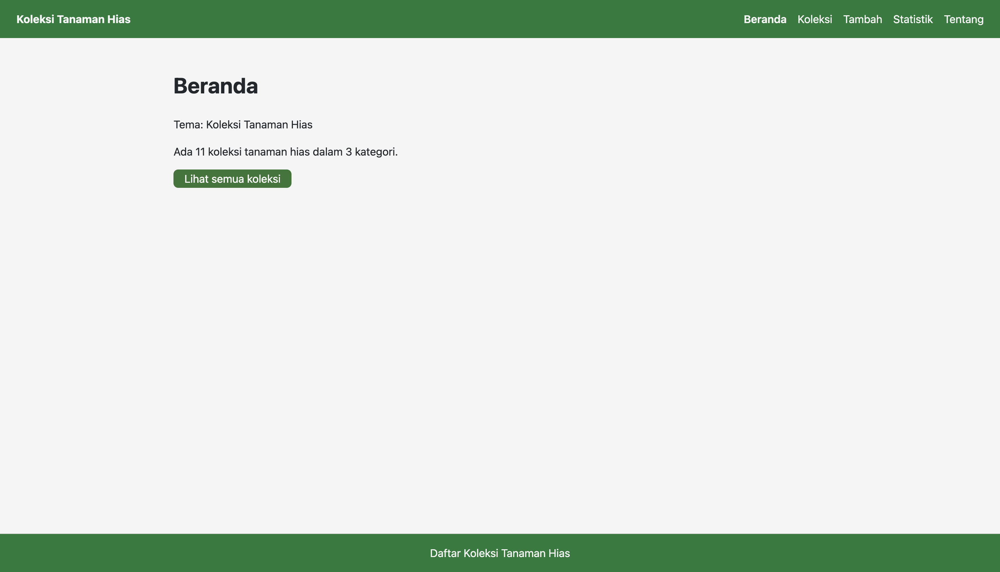
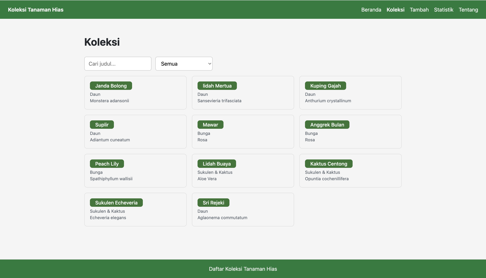
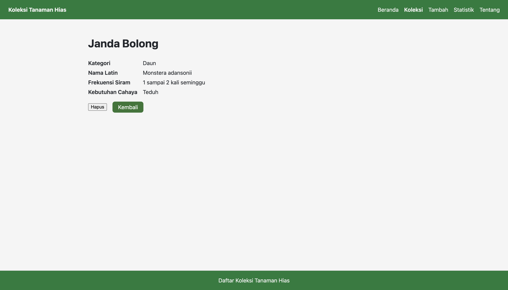
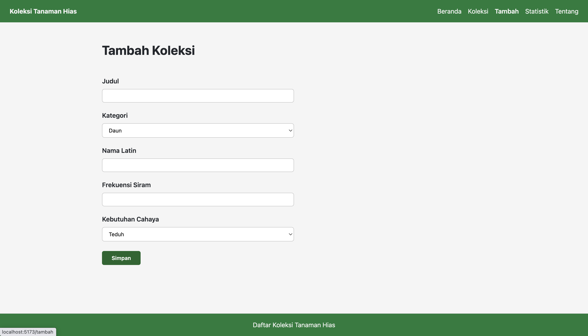
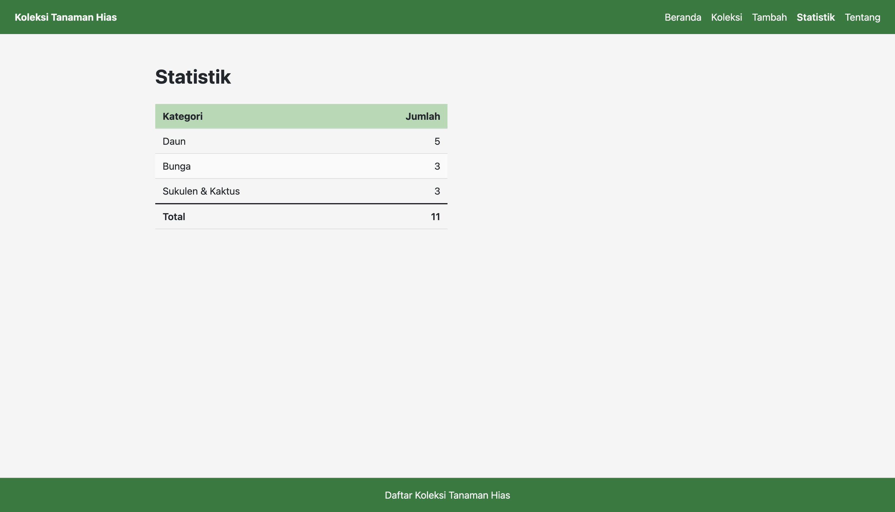
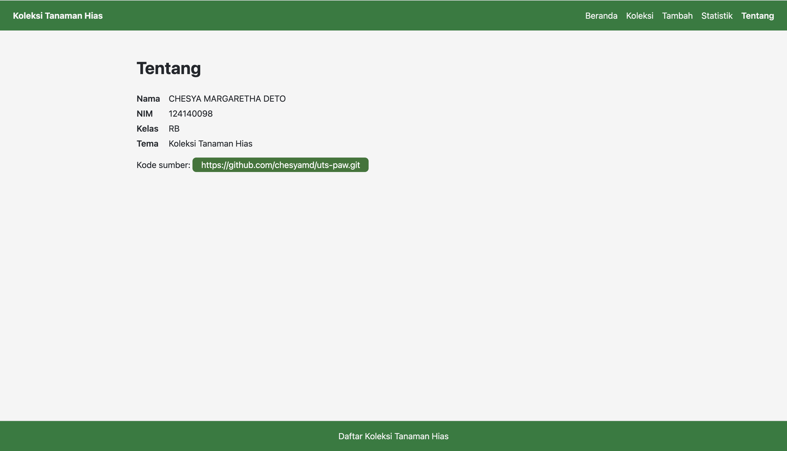
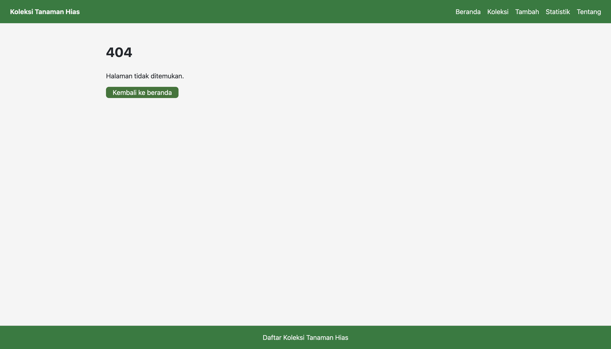

# Ujian Tengah Semester IF25-22014 Pengembangan Aplikasi Web

## Koleksi Tanaman Hias

- **Nama**: Chesya Margaretha Deto
- **NIM**: 124140098
- **Kelas**: RB
- **Tema**: Koleksi Tanaman Hias
- **Deployment**: https://chesyamd.github.io/uts-paw/

### Halaman Beranda

### Halaman Koleksi

### Halaman untuk Menghapus Item

### Halaman Tambah

### Halaman Statistik

### Halaman Tentang

### Halaman 404*

## Fitur
- Fitur pencarian item tanaman hias berdasarkan judul
- Fitur pengelompokan item tanaman hias berdasarkan kategori
- Fitur untuk menghapus item pada halaman Koleksi
- Fitur untuk menghitung dan menampilkan jumlah item per kategori pada halaman Statistika

## Menjalankan secara lokal

- cd app
- npm install
- npm run dev

## Konsep React yang dipakai

- Hook useLocalStorage untuk menyimpan state ke LocalStorage setiap kali berubah
- Context dan Provider untuk mengambil data awal dengan fetch, menyimpannya dan membagikannya ke semua halaman
- Hook useKoleksi supaya setiap halaman cukup menulis useKoleksi() untuk mendapatkan data dan fungsi tambah/hapus
- React Router untuk navigasi aplikasi
